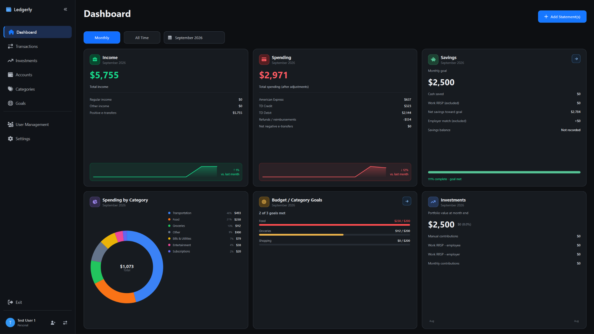
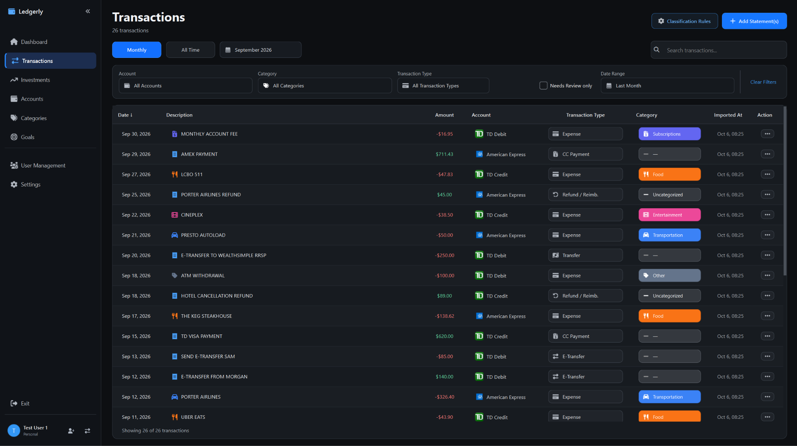
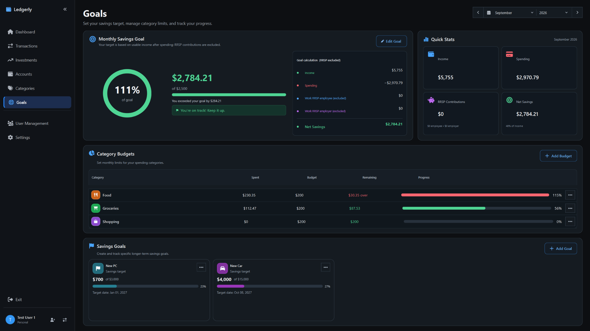
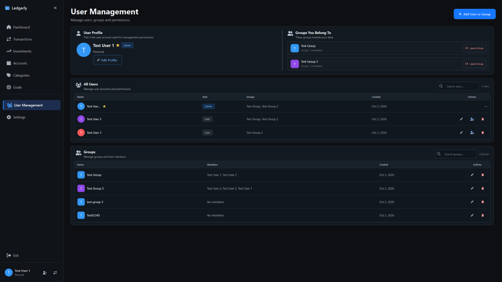

<div align="center">

# Ledgerly

**Private, local-first personal finance tracking for your desktop.**

[Highlights](#highlights) · [Screenshots](#a-closer-look) ·
[Download](#download-and-install) · [Privacy](#local-data-and-privacy) ·
[Development](#run-from-source)

[](https://github.com/mattnits/FinancesApp/actions/workflows/build-desktop.yml)


Ledgerly brings transactions, spending trends, budgets, savings goals, and
investments together in one focused desktop app. Your financial data stays on
your computer—no cloud account, subscription, or internet connection required.

</div>



## Why Ledgerly?

Most finance tools require a cloud account or constant manual entry. Ledgerly
is designed for people who want a clear view of their finances while keeping
control of their data. Import supported bank statements, review the results,
and let Ledgerly turn them into useful monthly and all-time insights.

## Highlights

- **Private by design** — Ledgerly stores its SQLite database and optional
  statement copies locally. The app does not upload your financial data.
- **Fast statement imports** — Import supported TD and American Express CSV
  statements, review possible duplicates, and retain a clean transaction history.
- **Useful transaction tools** — Search, filter, categorize, restore removed
  entries, and create reusable classification rules.
- **Clear financial reporting** — Compare income, spending, savings, category
  totals, budgets, and investments across monthly and all-time views.
- **Goals that stay visible** — Track monthly savings targets, category budgets,
  and longer-term goals with progress indicators.
- **Investment tracking** — Record TFSA, FHSA, RRSP, and general investment
  accounts, including payroll-based work RRSP contribution estimates.
- **Multiple profiles and groups** — Keep personal finances separate or create
  shared group views with configurable membership and permissions.
- **Self-contained desktop builds** — Windows and Linux downloads include
  Python and all required runtime packages.

## A closer look

### Review and organize transactions

Search across imported activity, filter by account, category, type, or date,
and correct classifications directly in the table.



### Set budgets and savings goals

See how income and spending affect monthly savings, monitor category limits,
and track longer-term goals from a single page.



### Manage personal and shared profiles

Create users and groups, review memberships, and control who can manage shared
financial views.



## Download and install

Download the files from the
[latest GitHub release](https://github.com/mattnits/FinancesApp/releases/latest).
Choose the package that matches your system:

| Package | Best for | How to launch |
| --- | --- | --- |
| `LedgerlySetup.exe` | Most Windows users | Run the installer, then open Ledgerly from the Start menu or optional desktop shortcut. |
| `Ledgerly-Windows-Portable.zip` | Windows users who prefer a portable app | Extract the entire archive and run `Ledgerly.exe`. Keep the executable and `_internal` folder together. |
| `Ledgerly-Linux.zip` | 64-bit Linux desktops | Extract the archive, open the `Ledgerly` folder, and run `./Ledgerly`. If needed, run `chmod +x Ledgerly` once first. |

These downloads are self-contained. You do **not** need to install Python, run
`setup.bat` or `setup.sh`, or download dependencies. The first launch prepares
Ledgerly's local storage and database; later launches reuse the same data.

> [!NOTE]
> The Windows installer is currently unsigned. Windows SmartScreen may show an
> “unrecognized app” message for a newly downloaded release.

The source-code archives automatically offered by GitHub are not prebuilt app
downloads. Use one of the Ledgerly packages listed above unless you intend to
run the project from source.

## System requirements

### Packaged application

- Windows 10 or 11, 64-bit; or
- 64-bit Linux with a graphical desktop, glibc 2.35 or newer (for example,
  Ubuntu 22.04 or newer), and Qt's XCB runtime libraries;
- permission to write to your user-data folder.

No network connection is required after downloading Ledgerly.

### Running from source

- Python 3.11 or newer with `venv` and `pip`;
- the packages declared in `requirements.txt`:
  PySide6 (`>=6.8,<7`), QtAwesome (`>=1.3,<2`), and SQLAlchemy (`>=2,<3`).

`pandas` and `matplotlib` are not required.

## Local data and privacy

Packaged builds use the operating system's writable user-data directory:

| Platform | Database | Saved statement copies |
| --- | --- | --- |
| Windows | `%LOCALAPPDATA%\Ledgerly\finance.db` | `%LOCALAPPDATA%\Ledgerly\imported_statements` |
| Linux | `$XDG_DATA_HOME/ledgerly/finance.db`, or `~/.local/share/ledgerly/finance.db` when `XDG_DATA_HOME` is unset | `imported_statements` beside the database |

Statement files are copied only when the save option is enabled during import.
Ledgerly keeps this information local, but it does not replace normal device
security. Protect your operating-system account, use disk encryption when
appropriate, and keep regular backups of `finance.db`.

## Run from source

Clone the repository, then use the setup script for your platform.

### Windows

```powershell
setup.bat
.venv\Scripts\python.exe main.py
```

### Linux

```bash
bash setup.sh
.venv/bin/python main.py
```

## Build desktop packages

Install the build dependencies and run PyInstaller on the operating system you
want to target:

```text
python -m pip install -r requirements-build.txt
python -m PyInstaller --noconfirm Ledgerly.spec
```

The portable application is created in `dist/Ledgerly`:

- Windows executable: `dist\Ledgerly\Ledgerly.exe`
- Linux executable: `./dist/Ledgerly/Ledgerly`

Distribute the **entire** `dist/Ledgerly` directory because the executable
depends on its adjacent `_internal` folder. PyInstaller cannot cross-build the
Windows package from Linux or the Linux package from Windows.

### Build the Windows installer

Install [Inno Setup 6](https://jrsoftware.org/isdl.php), then double-click
`build-windows-installer.bat` or run it with an optional version number:

```text
build-windows-installer.bat 1.0.0
```

The resulting installer is written to `dist/LedgerlySetup.exe` and installs
Ledgerly under `%LOCALAPPDATA%\Programs\Ledgerly` without requiring
administrator access.

### Automatic local builds after commits

Windows contributors can enable the repository's post-commit build hook once:

```text
git config --local core.hooksPath .githooks
```

After each local commit, the hook runs `build-windows-installer.bat` and creates
or updates `Ledgerly.lnk` in the repository root. The shortcut targets
`dist\Ledgerly\Ledgerly.exe`. Generated builds and the machine-specific shortcut
remain local and are not committed.

### Continuous delivery

The **Build desktop downloads** GitHub Actions workflow builds and smoke-tests
Windows and Linux packages. Pushing a `v*` tag publishes the Windows installer,
Windows portable ZIP, and Linux ZIP to GitHub Releases. Manual workflow runs
retain the packages as downloadable workflow artifacts.

## Tests

Run the test suite without opening desktop windows:

### PowerShell

```powershell
$env:QT_QPA_PLATFORM = 'offscreen'
python -m unittest discover -s tests -v
```

### Bash

```bash
QT_QPA_PLATFORM=offscreen python -m unittest discover -s tests -v
```
